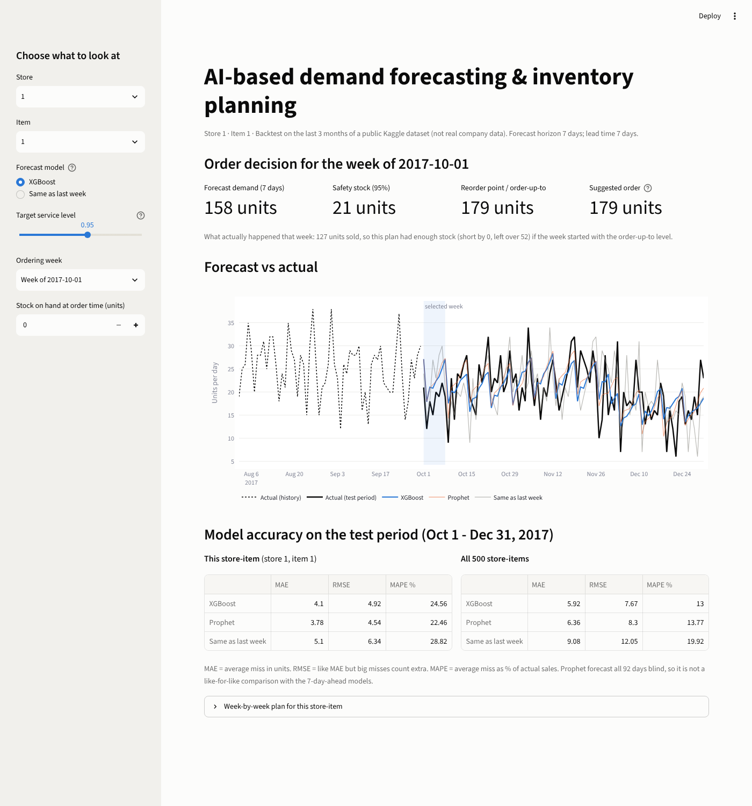
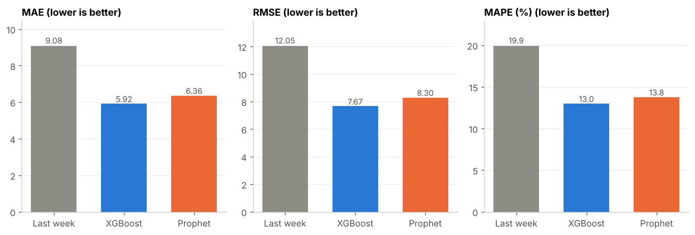
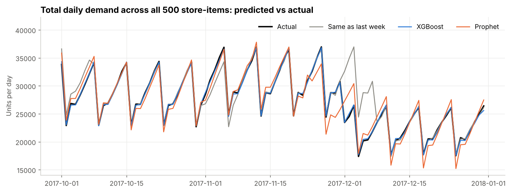
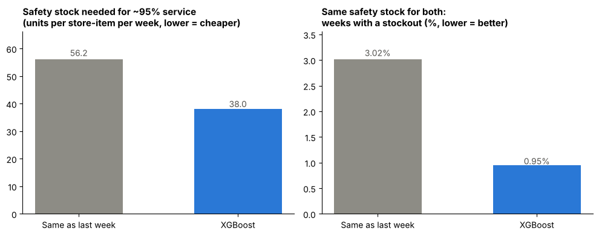

# AI-Based Demand Forecasting & Inventory Planning

Forecast daily demand for every store-item pair, then turn the forecast into an
inventory decision: how much **safety stock** to hold and what to **reorder**.



## Problem statement

A retailer with 10 stores and 50 items has to decide each week how much of every item
to stock. Order too little and you lose sales (stockouts); order too much and cash is
tied up in unsold inventory. This project builds a forecast for each of the 500 store-item
pairs, measures how wrong it typically is, and converts that error into a safety stock
and reorder level, then compares the result against the naive "same as last week" rule.

## Data

[Kaggle: Store Item Demand Forecasting Challenge](https://www.kaggle.com/competitions/demand-forecasting-kernels-only/data),
`train.csv`: 913,000 rows of daily sales (`date, store, item, sales`),
2013-01-01 to 2017-12-31, 10 stores x 50 items, no missing values or duplicates.
This is a public competition dataset that looks synthetic, **not a real company's data**.

## Approach

| Stage | What was done | Code |
|---|---|---|
| 1. Data check | Load, validate columns, summarise | `src/data_loader.py` |
| 2. EDA | Trend, weekly and yearly seasonality, store and item differences | `src/eda.py` |
| 3. Features | Calendar features; lags of 7, 14, 21, 28 and 364 days; 7- and 28-day rolling mean and 28-day rolling std. All built from data at least 7 days old, with a test that rebuilds 200 random rows from older history and confirms no leakage | `src/features.py` |
| 4. Baseline | "Same as last week" | `src/baseline.py` |
| 5. Models | XGBoost (one model for all 500 pairs, early stopping on a validation quarter) and Prophet (one model per pair) | `src/train_xgboost.py`, `src/train_prophet.py` |
| 6. Evaluation | MAE, RMSE, MAPE on identical test rows | `src/evaluate.py` |
| 7. Inventory | Safety stock and reorder level from forecast error; 13-week ordering simulation | `src/inventory.py` |
| 8. Dashboard | Streamlit app | `app/dashboard.py` |

**Time-based split:** train on 2013-02-04 to 2017-09-30, test on the last 92 days
(2017-10-01 to 2017-12-31, 46,000 rows). A random split would let the model learn from days
after the ones it is tested on, which flatters the scores.

**Forecast horizon:** 7 days. Features never use data newer than that.

## Results

All numbers are on the same 46,000 test rows (500 store-items x 92 days).

| Model | MAE (units) | RMSE (units) | MAPE | MAE vs baseline |
|---|---|---|---|---|
| Same as last week | 9.08 | 12.05 | 19.9% | n/a |
| **XGBoost** | **5.92** | **7.67** | **13.0%** | **-34.7%** |
| Prophet | 6.36 | 8.30 | 13.8% | -30.0% |




- XGBoost beat the baseline on all 500 store-items and beat Prophet on 88.6% of them.
- **Fairness note:** Prophet forecast all 92 test days from one cut-off with no recent sales,
  while XGBoost forecast 7 days ahead with fresh lags. XGBoost vs baseline is a like-for-like
  comparison; XGBoost vs Prophet is not.
- Most useful features for XGBoost: sales 7 days ago, the 7-day average, sales 14 days ago.

### Inventory results

Assumptions: weekly orders, 7-day lead time, 95% target service level (safety stock =
1.645 x typical weekly forecast error, measured on Jul-Sep 2017, before the test period).
13 test weeks x 500 store-items = 6,500 order decisions per model.

| | Same as last week | XGBoost |
|---|---|---|
| Safety stock per store-item-week (own error, 95% target) | 56.20 | 38.03 (-32%) |
| Average stock left at week end | 66.05 | 38.14 (-42%) |
| Weeks with a stockout (own safety stock) | 3.02% | 4.68% |
| Weeks with a stockout (same safety stock for both) | 3.02% | 0.95% (-68%) |
| Units short per store-item-week (same safety stock) | 0.36 | 0.06 |



Plain reading: a more accurate forecast needs a smaller cushion for roughly the same
service level, and for the same cushion it runs out far less often. With **no** safety stock,
XGBoost actually has more stockout weeks (49.0% vs 42.5%) because the baseline over-forecasts
by about 1.3 units a day, which acts as an accidental cushion; XGBoost is unbiased. Savings
are in units, not money, since the dataset has no prices or costs.

## How to run

1. Install Python 3.10 or newer.
2. Create and activate a virtual environment:
   ```bash
   python -m venv .venv
   .venv\Scripts\activate          # Windows
   source .venv/bin/activate       # macOS / Linux
   ```
3. Install packages: `pip install -r requirements.txt`
4. Download `train.csv` from the Kaggle link above and put it at `data/raw/train.csv`
   (the raw data is not stored in this repo).
5. Run every stage (about 2 minutes on a 4-core machine): `python run_pipeline.py`
   (or run a single stage, e.g. `python -m src.features`).
6. Launch the dashboard: `streamlit run app/dashboard.py`

Shortcut: the generated files (`data/processed/` and `models/`) are already included in this repo,
so after step 4 you can skip step 5 and go straight to the dashboard.

The full pipeline was re-run from scratch in a clean copy of the project and reproduced
the same results table.

## Project structure

```
├── data/raw/            # train.csv goes here (not included in the repo)
├── data/processed/      # features, predictions, simulation (created by the scripts, included)
├── src/                 # all stage code (see table above) + config.py, evaluation.py
├── app/dashboard.py     # Streamlit dashboard
├── reports/             # figures, results table, plain-English notes per stage
├── models/              # saved XGBoost model (included)
├── run_pipeline.py      # runs all stages in order
└── requirements.txt
```

## Limitations

- **Public, apparently synthetic data**, not a real company's. Real data brings promotions,
  price changes, stockouts, new products and supply delays that are not modelled here.
- **Sales is not demand.** Days with empty shelves would hide true demand; there is no stock data to correct for it.
- **One test quarter** (Q4 2017). Rankings and inventory numbers could differ in other seasons.
- **Simplified inventory model:** weekly orders, fixed 7-day lead time, no ordering or holding costs,
  no supplier delays, no minimum order sizes, no carry-over between weeks.
  The 95% service target is calibrated on one quarter and assumed to carry over.
- **Prophet comparison is not like-for-like** (92-day blind forecast vs 7-day-ahead).
- No hyperparameter search beyond sensible defaults and early stopping. Prophet's US-holiday setting is an assumption.
- No forecast intervals, and the forecast is a single number per day.

## Future work

- Tune XGBoost (and try LightGBM) with time-series cross-validation across several test periods.
- Make Prophet and XGBoost comparable by giving both the same horizon, and try an ensemble.
- Probabilistic forecasts (quantile regression) to size safety stock directly from the predicted distribution.
- Add costs (holding, stockout, ordering) to optimise service level per item instead of a flat 95%.
- Variable lead times, minimum order quantities and ABC classification of items.
- Test on a real dataset with prices, promotions and stock levels.
